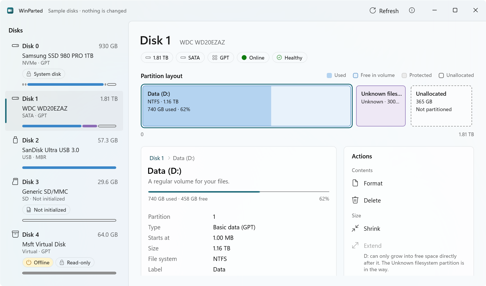

# WinParted

[](https://github.com/petrjancar/WinParted/actions/workflows/ci.yml)
[](https://opensource.org/licenses/MIT)
[](https://ko-fi.com/petrjancar)

A free, open-source disk and partition manager for Windows 11 with a modern, native UI.

> **Status:** early development. Use at your own risk.

<picture>
  <source media="(prefers-color-scheme: dark)" srcset="docs/images/screenshot-dark.png">
  
</picture>

## What it does (MVP)

- **See your disks:** every disk with its health, bus type and partition style, a visual partition map, and used/free space per volume. Updates automatically when you plug in or remove a drive.
- **Disk operations:** initialize (GPT or MBR), bring online / take offline, clear disk.
- **Partition operations:** create (and format), delete, format, shrink and extend, change drive letter, change label.
- **Safety first:** system partitions (EFI, Recovery, the Windows volume and others) are always shown but locked against destructive changes, and every unavailable action tells you why.

Operations run immediately after you confirm them. There is no pending queue.

## Limitations

WinParted uses the [Windows Storage Management API](https://learn.microsoft.com/en-us/windows-hardware/drivers/storage/windows-storage-management-api-portal), so it can do what Windows itself supports and no more:

- **Partitions can't be moved.** A volume can only grow into free space directly after it. (This is why "Extend" is often unavailable for C: when a Recovery partition follows it.)
- **Only NTFS and ReFS volumes can be resized.**
- Linux filesystems (ext4, btrfs, ...) are shown as "Unknown filesystem" and can only be deleted.
- Dynamic disks and Storage Spaces are shown but can't be changed.

## Requirements

- **Windows 11**.
- Administrator rights: WinParted asks for them when it starts.

## Install, update and uninstall

Download from [Releases](https://github.com/petrjancar/WinParted/releases):

- **Installer** (`WinParted-<version>-setup.exe`, recommended): installs WinParted for all users in `C:\Program Files\WinParted` and adds it to the Start menu. Windows asks for administrator rights.
- **Portable zip** (`WinParted-<version>-win-x64.zip`): extract it anywhere and run `WinParted.exe`. Nothing is installed.

WinParted isn't code-signed yet, so Windows SmartScreen may warn about an unknown publisher. Choose **More info → Run anyway**.

**Updates:** when a newer version is published, WinParted shows a notice with a link to it (one request to GitHub when it starts; nothing about your PC or disks is sent). You can turn this off, or include pre-releases, in **About**. To update, run the new installer: it replaces the old version and keeps your settings. With the zip, replace the folder.

**Uninstall:** Settings → Apps → Installed apps → WinParted → Uninstall (or **Uninstall WinParted** in the Start menu). This removes the app, its Start menu entries, settings and log; nothing is left behind.

## Files WinParted creates

WinParted writes to one folder only: `%ProgramData%\WinParted` (usually `C:\ProgramData\WinParted`), the same for every user account. It holds the settings (`settings.json`) and a diagnostic log (`winparted.log`). Uninstalling removes it. If you use the portable zip, delete this folder by hand together with the app folder.

Version 0.1.0 kept its log in `%LOCALAPPDATA%\WinParted` instead. Newer versions don't use that folder any more, and the uninstaller removes it for the account that runs it.

## Building

Prerequisites: [.NET 10 SDK](https://dotnet.microsoft.com/download/dotnet/10.0). Visual Studio 2026 (with the "WinUI application development" workload) is optional but recommended for working on the UI.

```bash
dotnet build
```

Run the unit tests:

```bash
dotnet test tests/WinParted.Core.Tests
```

Run the app from an **elevated** terminal (Terminal (Admin)) to see your real disks:

```bash
dotnet run --project src/WinParted.App
```

Release builds always ask for administrator rights. Debug builds start without them and then show
the "needs administrator rights" screen, which makes that screen and sample mode easy to try.

**Sample mode** shows the design's example disks and never changes anything:

```bash
dotnet run --project src/WinParted.App -- --sample
```

Developer options: `--theme dark|light`, `--culture <name>` (number formatting, e.g. `en-US`), `--select <disk>[:<segment>]` (e.g. `--select 0:2`), `--open <action>` (e.g. `--open ClearDisk`) and `--pretend-version <x.y.z>` (the update check compares GitHub's releases with this version, and runs even without administrator rights).

Publish a self-contained release build (no .NET or Windows App SDK needed on the target PC):

```bash
dotnet publish src/WinParted.App -c Release -r win-x64 -o artifacts/WinParted-win-x64
```

Run `WinParted.exe` from that folder; Windows asks for administrator rights.

`tests/WinParted.Storage.IntegrationTests` create and modify temporary virtual disks (VHDX), never your real disks, and need an elevated terminal.

## Releasing

The version is set in one place: `<Version>` in `Directory.Build.props` (About, the update check, the zip and the installer all use it). Update the .NET SDK first: the release bundles the .NET runtime from the SDK that builds it.

1. Publish the self-contained build (above).
2. Zip the published folder as `artifacts/WinParted-<version>-win-x64.zip`.
3. Build the installer with [Inno Setup 6](https://jrsoftware.org/isinfo.php) (`ISCC.exe` on `PATH`), from the repository root:

   ```powershell
   $version = (dotnet msbuild src/WinParted.App/WinParted.App.csproj -getProperty:Version).Trim()
   iscc "/DAppVersion=$version" installer\WinParted.iss
   ```

   This creates `artifacts/WinParted-<version>-setup.exe`. CI builds it too, on every push and pull request.
4. Attach the zip and the installer to a draft GitHub release (tag `v<version>`), then publish it.

## Project layout

| Path | Contents |
|---|---|
| `src/WinParted.App` | WinUI 3 user interface |
| `src/WinParted.Core` | Disk model, safety rules and action availability (no Windows APIs, fully unit tested) |
| `src/WinParted.Storage` | Access to the Windows Storage Management API |
| `tests/` | Unit and integration tests |
| `docs/design/` | UI design briefs |
| `installer/` | Inno Setup script for the installer |
| `openspec/` | Specifications and planned changes |

## License

[MIT](LICENSE)
